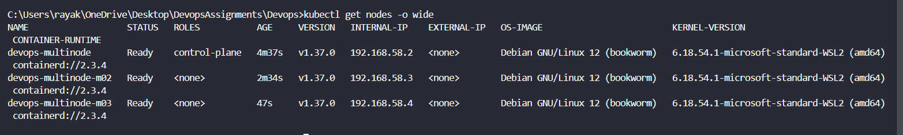
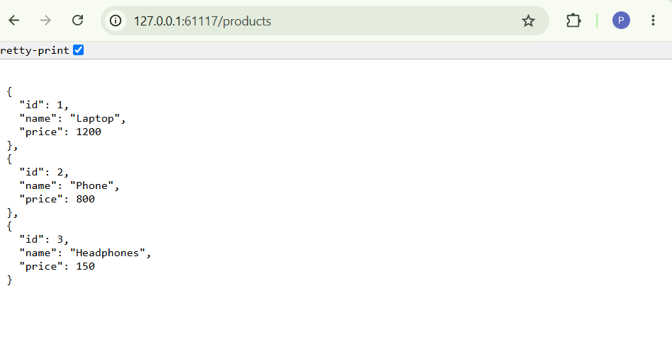
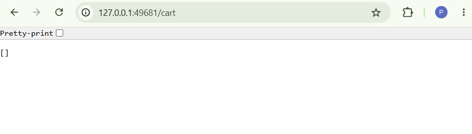
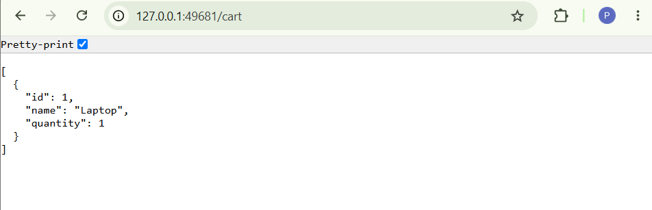

# Assignment 10: Multi-Node Kubernetes Cluster with Multiple Applications and Replicasets

## Objective
To deploy two Flask applications on a multi-node Kubernetes cluster using Minikube, Docker, Kubernetes Deployments, and Services. The Product Catalog application runs 2 replicas, while the Shopping Cart application runs 3 replicas distributed across multiple nodes for availability and fault tolerance.

## Technologies Used
- Python and Flask
- Docker
- Kubernetes
- Minikube
- YAML
- Git and GitHub

## Applications

### 1. Product Catalog (AppA)
Provides a REST API to retrieve available products.

**Endpoint:** `/products`

Returns a JSON list containing:
- Laptop
- Phone
- Headphones

**Replicas:** 2

### 2. Shopping Cart (AppB)
Provides REST API endpoints to view the shopping cart and add items.

| Method | Endpoint | Description |
|---|---|---|
| GET | `/cart` | Retrieves cart items |
| POST | `/cart` | Adds an item to the cart |

**Replicas:** 3

## Project Structure

```text
10-Minicube Multi node/
├── Screenshots/
│   ├── cartAdded.png
│   ├── initialCart.png
│   ├── nodes.png
│   └── product-catalog.png
├── Dockerfile.product
├── Dockerfile.shopping
├── product_catalog.py
├── shopping_cart.py
├── product_catalog_deployment.yaml
├── shopping_cart_deployment.yaml
├── product_catalog_service.yaml
├── shopping_cart_service.yaml
└── README.md
```

## Implementation Steps

### Step 1: Create the Multi-Node Cluster

```bash
minikube start --nodes 3 -p devops-multinode
kubectl get nodes -o wide
```

The cluster contains one control-plane node and two additional nodes.

### Step 2: Build Docker Images

Build the Product Catalog and Shopping Cart images:

```bash
docker build -t product-catalog:latest -f Dockerfile.product .
docker build -t shopping-cart:latest -f Dockerfile.shopping .
```

Load the images into Minikube:

```bash
minikube -p devops-multinode image load product-catalog:latest
minikube -p devops-multinode image load shopping-cart:latest
```

### Step 3: Deploy Applications

Apply the Kubernetes deployment manifests:

```bash
kubectl apply -f product_catalog_deployment.yaml
kubectl apply -f shopping_cart_deployment.yaml
```

The Product Catalog deployment specifies 2 replicas, and the Shopping Cart deployment specifies 3 replicas. Pod anti-affinity is configured to distribute replicas across different nodes.

### Step 4: Expose Applications

Create Kubernetes Services:

```bash
kubectl apply -f product_catalog_service.yaml
kubectl apply -f shopping_cart_service.yaml
```

### Step 5: Verify the Cluster

```bash
kubectl get nodes -o wide
kubectl get pods -o wide
kubectl get deployments
kubectl get services
```

Expected deployment replica counts:

- Product Catalog: 2/2
- Shopping Cart: 3/3

All five pods should be running and distributed across the three nodes.

### Step 6: Access and Test the Applications

Start the Product Catalog service tunnel:

```bash
minikube -p devops-multinode service product-catalog-service
```

Access `/products` using the URL displayed by Minikube.

Start the Shopping Cart service tunnel:

```bash
minikube -p devops-multinode service shopping-cart-service
```

Access `/cart` using the URL displayed by Minikube.

Test adding an item to the cart using `curl`:

```bash
curl -X POST http://127.0.0.1:PORT/cart -H "Content-Type: application/json" -d "{\"id\":1,\"name\":\"Laptop\",\"quantity\":1}"
```

Replace `PORT` with the port in the active Shopping Cart tunnel URL.

## Screenshots

### 1. Multi-Node Cluster


Shows the Kubernetes cluster nodes.

### 2. Product Catalog API


Shows the Product Catalog API response.

### 3. Initial Shopping Cart


Shows the initial empty cart response.

### 4. Shopping Cart After Adding an Item


Shows the cart response after adding an item.

## Conclusion

This assignment demonstrates deploying multiple containerized Flask applications on a three-node Minikube cluster. Kubernetes Deployments manage the required replicas, pod anti-affinity distributes replicas across nodes, and Services expose the applications for testing.
