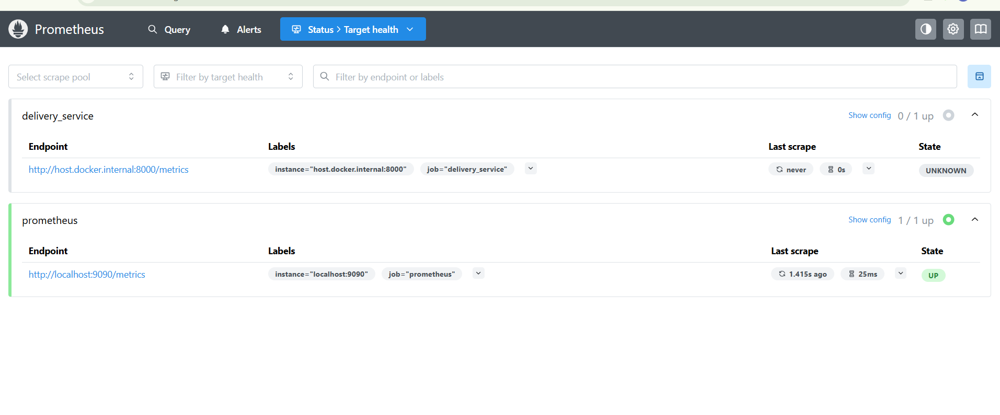
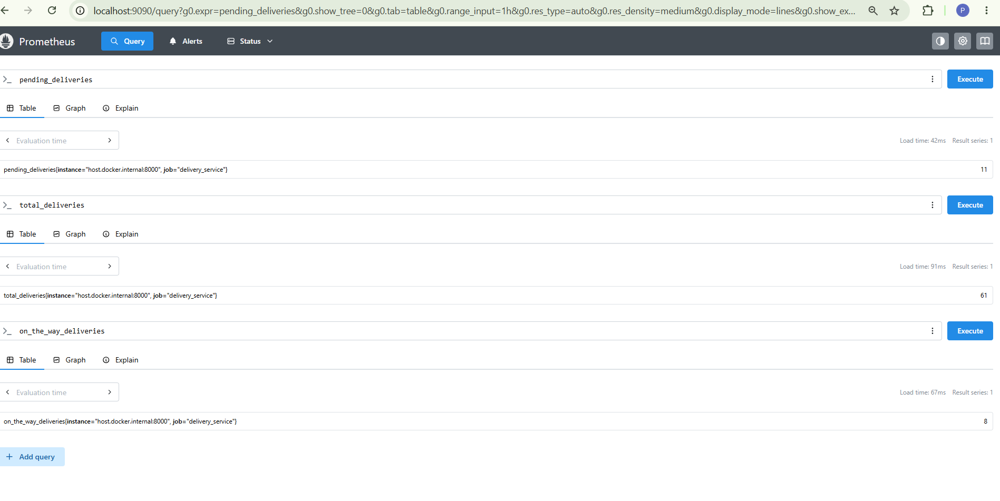
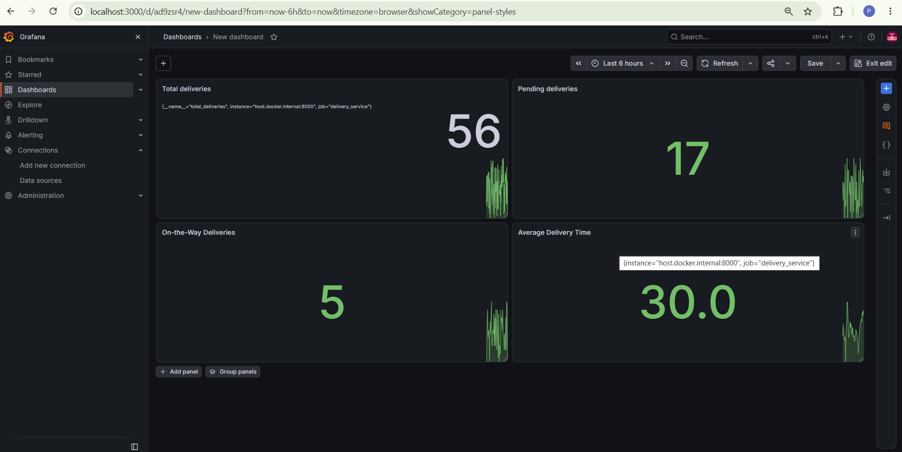
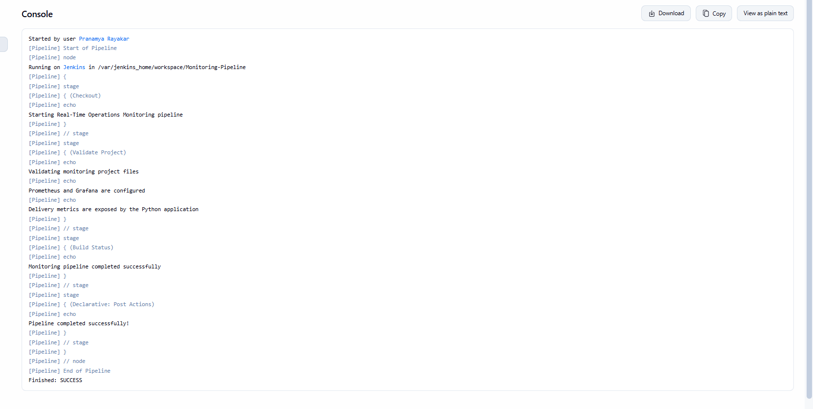

# Real-Time Operations Monitoring and Alerting

## Overview

This project implements a real-time operations monitoring system using Python, Prometheus, Grafana, Docker, and Jenkins. It simulates delivery operations, collects performance metrics, visualizes them through a Grafana dashboard, and configures alerts for abnormal delivery conditions.

## Objectives

- Monitor delivery-related metrics in real time.
- Collect and expose application metrics using Prometheus.
- Visualize delivery statistics using Grafana dashboards.
- Configure alert rules for high pending deliveries and increased average delivery time.
- Containerize the Python application using Docker.
- Demonstrate pipeline execution using Jenkins.

## Technologies Used

- **Python** – Simulates delivery data and exposes metrics.
- **Prometheus** – Collects and stores application metrics.
- **Grafana** – Visualizes metrics through dashboards.
- **Docker** – Containerizes the Python application and runs monitoring services.
- **Jenkins** – Demonstrates pipeline execution.

## Project Structure

```text
6-Grafana-Monitoring/
├── Screenshots/
│   ├── alerts verification.png
│   ├── Grafana-output.png
│   ├── jenkins-output.png
│   ├── metrics-output.png
│   ├── Prometheus-alerts.png
│   └── Prometheus-target.png
├── alert_rules.yml
├── delivery_metrics.py
├── Dockerfile
├── Jenkinsfile
├── prometheus.yml
└── README.md
```

## Application Metrics

The Python application simulates delivery operations and exposes the following metrics on port `8000`:

- **Total Deliveries:** Total number of simulated deliveries.
- **Pending Deliveries:** Number of deliveries waiting to be completed.
- **On-the-Way Deliveries:** Number of deliveries currently in transit.
- **Average Delivery Time:** Delivery time observations recorded by the application.

The metrics are updated periodically using randomly generated values.

## Prometheus Configuration

Prometheus scrapes metrics at five-second intervals.

The configuration in `prometheus.yml` defines the Prometheus server and the delivery application as scrape targets.

The delivery application is configured using:

```yaml
- job_name: "delivery_service"
  static_configs:
    - targets: ["host.docker.internal:8000"]
```

The target status can be checked at:

http://localhost:9090/targets

## Alerting

Alert rules are defined in `alert_rules.yml`.

Two alerts are configured:

1. **HighPendingDeliveries:** Triggers when pending deliveries exceed 10 for 15 seconds.
2. **HighAverageDeliveryTime:** Triggers when the calculated average delivery time exceeds 30 seconds for 15 seconds.

Alert status can be viewed at:

http://localhost:9090/alerts

## Grafana Dashboard

Grafana is used to visualize the collected Prometheus metrics.

The `Delivery Operations Monitoring` dashboard contains four Stat panels:

- Total Deliveries
- Pending Deliveries
- On-the-Way Deliveries
- Average Delivery Time

Grafana is accessible at:

http://localhost:3000

The Prometheus data source is configured to use `http://host.docker.internal:9090`.

## Docker Setup

The Python application is containerized using the provided `Dockerfile`.

To build the Docker image, run the following command from this project directory:

```bash
docker build -t delivery-metrics .
```

To run the application container:

```bash
docker run -d --name delivery-metrics-test -p 8001:8000 delivery-metrics
```

The metrics can then be accessed at:

http://localhost:8001/metrics

To stop and remove the test container:

```bash
docker rm -f delivery-metrics-test
```

## Jenkins Pipeline

Jenkins is used to demonstrate pipeline execution for the monitoring project. A basic pipeline was executed successfully to display pipeline stages and completion status.

The pipeline demonstrates Jenkins job execution. Automated Docker image building and deployment of the complete monitoring stack through Jenkins remain incomplete because Docker access from the Jenkins container has not yet been configured.

## Screenshots

### Application Metrics


### Prometheus Targets



### Prometheus Alerts



### Alert Verification


### Grafana Dashboard



### Jenkins Pipeline



## Conclusion

This project demonstrates how application metrics can be generated, collected, monitored, and visualized using Python, Prometheus, and Grafana. It also demonstrates alert configuration, Docker-based application execution, and Jenkins pipeline execution. These components provide a foundation for building automated monitoring and alerting systems for real-world applications.
